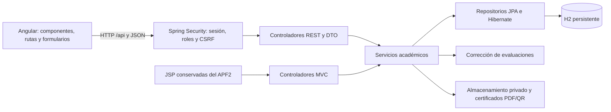

# Arquitectura implementada — Avance 3

## Organización y continuidad

La tercera etapa del curso incorpora Angular y API REST sobre el backend Java existente. El backend sigue siendo un monolito por capas con Spring Boot y Spring MVC: los controladores REST forman parte de Spring MVC y llaman a los mismos servicios que utilizan las vistas JSP conservadas. La base de datos, el almacenamiento y las reglas académicas se mantienen.

El WAR integrado sirve Angular, la API y los recursos estáticos en el mismo origen. No se añadió un servidor de negocio en Node.js ni una división en microservicios. Node/npm se necesitan para compilar el frontend, no para ejecutar el WAR.

## Componentes

| Ubicación | Responsabilidad |
|---|---|
| `frontend/src/app/core` | Modelos TypeScript, cliente HttpClient, sesión, interceptor CSRF, guard y traducción de errores |
| `frontend/src/app/shared` | Editor modal con formularios reactivos, esquemas de campos, estado de consultas, tarjetas, temario y comentarios |
| `frontend/src/app/pages` | Acceso, catálogo, paneles, administración, gestión docente, aula y portal del estudiante |
| `frontend/src/app/routes.ts` | Rutas conservadas, aliases con filtros, guards por perfil y carga diferida de pantallas |
| `api/ApiAuthController` | Inicio/cierre de sesión, registro, consulta de identidad y token CSRF |
| `api/ApiController` | Adaptación de operaciones JSON a servicios existentes, validación y respuestas HTTP |
| `api/ApiViews` | Campos de salida explícitos: no expone hashes, claves de archivo ni soluciones antes de responder |
| `api/ApiFilesController` | Descargas privadas de material, entregas, CSV y certificados |
| `api/ApiErrors` | Errores JSON y validaciones por campo; estados 400/401/403/404/409/413/422 |
| `config` | Seguridad, datos ficticios y despacho de navegación HTML a Angular |
| `service` | Identidad, permisos por recurso, acceso, pagos, progreso, entregas, evaluaciones, participación, archivos y certificados |
| `repository` y `domain` | Persistencia JPA, consultas JPQL, entidades y restricciones |
| `web` y `web/form` | Controladores y DTO de la etapa JSP conservada; los DTO válidos también se usan como entradas REST |
| `resources/db/migration` | Esquema Flyway V1–V5; la incorporación de Angular no altera las tablas |

## Navegación y formularios

Spring entrega el documento Angular en las solicitudes de navegación HTML. Las llamadas `/api`, los recursos y las descargas se procesan por separado. Las rutas públicas y por rol se conservan: catálogo en `/`, aliases `/cursos` y `/catalogo` con filtros, detalles `/cursos/{id}`, paneles, administración, gestión, contenidos, resultados y certificados.

Las rutas históricas de crear/editar abren el contexto de listado/aula y su modal. Los botones normales mantienen al usuario en la misma pantalla. El editor compartido conserva los valores y errores del servidor; evita envíos duplicados mientras guarda y usa un diálogo nativo con foco contenido. La cuenta móvil sigue al pie del sidebar con menú ascendente y los ocho enlaces administrativos conservan su orden.

Los estilos siguen siendo Tailwind compilado localmente junto con la hoja existente. No se introdujo una biblioteca visual distinta. La estructura Angular reutiliza títulos, campos, tablas, clases, logotipos y acciones de las pantallas JSP.

## Autenticación y autorización

La sesión del servidor conserva la identidad mediante cookie HttpOnly y SameSite=Lax. El login JSON autentica credenciales BCrypt, cambia el identificador de sesión y registra el acceso. Iniciar/cerrar sesión exige CSRF; Angular vuelve a obtener el token después del acceso o la salida. No se guarda la contraseña ni una credencial de autenticación en localStorage y no se agregó JWT.

Los guards controlan la navegación por perfil. Spring Security y los servicios aplican los permisos reales, también cuando se invoca la API directamente. Se revalida la cuenta activa y su rol en cada petición. El docente necesita asignación al curso; el estudiante necesita matrícula vigente y solo descarga sus evidencias. La vista administrativa de perfiles permanece en solo lectura.

La política CSP continúa restringiendo scripts/estilos al propio servidor. Angular se compila anticipadamente sin estilos críticos en línea. El proxy de desarrollo envía `/api`, imágenes y estilos a Spring Boot, evitando una política CORS permisiva.

## Datos y consistencia

Se conserva H2 persistente, JPA/Hibernate y Flyway V1–V5. Las pruebas usan bases en memoria y almacenamiento de pruebas, separados de los registros locales.

Pago y habilitación/actualización de matrícula comparten la transacción; la edición de pagos conserva identidad y version. La finalización de contenido es idempotente y depende de acceso vigente, sin exigir previamente entrega, publicación ni aprobación. Se conservan intentos, resultados ponderados, calificaciones 0–20 y reglas de certificación. Las restricciones y bloqueos siguen protegiendo matrículas, finalizaciones, intentos y certificados frente a duplicación concurrente.

Los DTO de temario público no incluyen el cuerpo del contenido ni su enlace privado. Las preguntas de estudiante omiten soluciones; los resultados autorizados y la gestión docente sí incluyen la explicación y respuesta esperada. Los archivos no se sirven desde una carpeta pública.

## Compilación y ejecución

`npm run build:ui` compila Tailwind y Angular. El frontend se genera en `src/main/resources/static/spa`, excluido de Git. `mvn -B package` ejecuta pruebas y empaqueta el WAR con esos recursos. `run.ps1` prepara las dependencias necesarias, realiza ambas compilaciones y levanta la aplicación en 127.0.0.1:8080.

Para desarrollo, `npm --prefix frontend start` utiliza el proxy hacia 8080. Para la verificación histórica JSP se configura `FRONTEND_ENABLED=false`. La suite MvcHttpSmokeTest usa expresamente esa configuración para seguir comprobando Tomcat/JSP real.

## Dependencias añadidas con uso efectivo

| Dependencia | Uso |
|---|---|
| Angular core/common/platform-browser | Componentes, señales, renderizado y arranque de la interfaz |
| Angular router | Rutas, aliases, guards y carga diferida |
| Angular forms | Formularios reactivos, validación y campos de modales |
| HttpClient, incluido en Angular common | Comunicación HTTP con contratos JSON |
| RxJS | Transporte HTTP, suscripciones a rutas y liberación al destruir componentes |
| Angular CLI/build/compiler-cli y TypeScript | Compilación anticipada del frontend |
| Vitest y jsdom | Pruebas de cliente HTTP, sesión, guards y modales |
| Playwright | Recorridos de Chromium contra el WAR real, capturas y descargas |

Las dependencias previas mantienen sus funciones: Spring Data JPA/Hibernate, Flyway, H2, Spring Security, Jakarta Validation, Jasper/JSTL, PDFBox y ZXing. No se cambió el motor de datos ni se añadieron pasarelas, Drive o correo.

Referencias: [Angular HttpClient](https://angular.dev/guide/http), [formularios reactivos](https://angular.dev/guide/forms/reactive-forms), [guards](https://angular.dev/guide/routing/route-guards), [Spring MVC](https://docs.spring.io/spring-framework/reference/web/webmvc.html), [CSRF en Spring Security 6.5](https://docs.spring.io/spring-security/reference/6.5/servlet/exploits/csrf.html).
