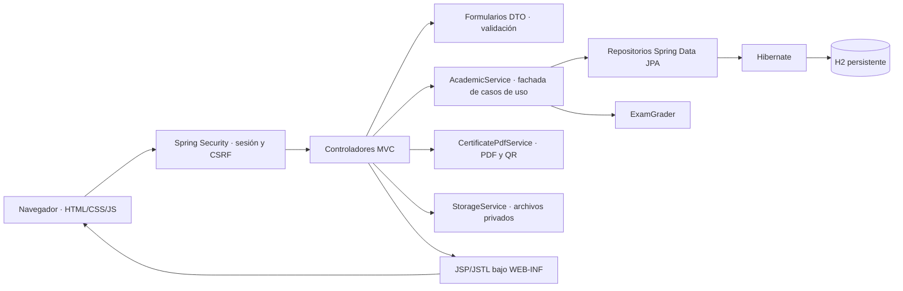

# Arquitectura implementada

## Organización

El sistema utiliza un monolito por capas. El navegador envía formularios HTTP y recibe páginas HTML producidas por JSP/JSTL. No se exponen controladores REST ni una API JSON. Las descargas PDF, archivos y CSV son respuestas de controladores MVC.

La fachada centraliza los contratos de los casos de uso académicos. La persistencia se encapsula en repositorios; la corrección de evaluaciones, la generación de documentos y el almacenamiento se separan en componentes especializados. Las vistas no consultan la base ni corrigen evaluaciones.

## Paquetes

| Paquete | Responsabilidad |
|---|---|
| `config` | Seguridad y carga inicial de datos locales |
| `domain` | Entidades, relaciones y enumeraciones |
| `repository` | Acceso a datos y consultas JPQL |
| `service` | Casos de uso, transacciones, corrección, archivos y certificados |
| `web` | Controladores MVC, modelos de vista y manejo de errores |
| `web.form` | Objetos de entrada validados y modelo de pregunta sin respuesta correcta |
| `WEB-INF/views` | Páginas JSP y fragmentos comunes |
| `WEB-INF/tags` | Tarjeta reutilizable de curso |
| `static/assets` | CSS, JavaScript e iconos SVG integrados en la vista |

## Controladores y contratos

| Controlador | Responsabilidad | Ejemplos de rutas |
|---|---|---|
| PublicController | Catálogo, registro, acceso y consulta autenticada de certificados | GET /, POST /registro, GET /login, GET /cert/{code} para estudiantes |
| PortalController | Panel, perfil, cursos propios, selección y logros | GET /dashboard, POST /carrito/solicitar, POST /certificados/emitir/{courseId} |
| AdminController | Usuarios, cursos, pagos, matrícula y auditoría | POST /admin/pagos/{id}/confirmar |
| ManagementController | Contenidos, cuestionarios, seguimiento y notas | POST /gestion/entregas/{id}/calificar |
| LearningController | Aula, progreso, entregas, evaluaciones y participación | POST /contenidos/{id}/evaluar |

Los controladores retornan vistas o redirecciones después de una operación exitosa. Las descargas devuelven contenido binario o CSV con Content-Disposition. Los errores de negocio muestran una página comprensible, con estado HTTP 422; los accesos denegados utilizan 403, y los datos malformados 400.

Los formularios de alta/edición se presentan en un diálogo común sobre el listado o aula. JavaScript obtiene HTML de las mismas vistas MVC o utiliza una plantilla local; envía el formulario con CSRF, muestra validaciones conservando datos y actualiza la pantalla después de guardar. Esto no constituye una API REST ni intercambia modelos JSON. Las rutas de formulario se conservan como alternativa de navegación, pero los botones habituales abren modales.

## Seguridad

- Inicio de sesión por formulario con Spring Security y sesión de servidor.
- Contraseñas BCrypt; no se guardan ni se muestran contraseñas originales.
- Revalidación de cuenta activa y rol en cada petición autenticada.
- Protección CSRF en escrituras y cierre de sesión; no se utiliza GET para mutar el negocio.
- Reglas por rol y por recurso: un docente debe estar asignado al curso; un estudiante solo consulta sus entregas, resultados y certificados.
- Matrícula vigente: estado ACTIVA, inicio alcanzado, vencimiento futuro y cuenta activa.
- Escape de texto con JSTL y formularios Spring; enlaces externos restringidos a HTTPS.
- QuestionView no contiene la respuesta correcta del cuestionario antes de enviarlo.
- Política CSP, archivos privados con nombres generados y descarga autorizada.
- Sesión de 30 minutos, cookie HttpOnly y SameSite=Lax.

Las vistas se guardan en WEB-INF para impedir su acceso directo. Los despachos internos FORWARD/ERROR se permiten para que Spring MVC pueda renderizar las JSP; esto no vuelve públicas las rutas de negocio protegidas.

## Consistencia

La confirmación de pago y la creación/actualización de matrícula ocurren en una transacción. Los intentos y el progreso bloquean la matrícula del participante para evitar duplicación concurrente. El cuestionario utiliza bloqueo de contenido para coordinar intentos y edición; una evaluación con intentos no permite cambiar preguntas ni su porcentaje de aprobación.

Las restricciones únicas impiden duplicar matrículas por estudiante/curso, progreso por estudiante/contenido, números de intento, valoraciones, reacciones y certificados por estudiante/curso. V2 incorpora rangos y estados válidos también en la base.

## Dependencias con uso efectivo

| Recurso | Uso |
|---|---|
| Spring Boot / Spring MVC | Arranque, Tomcat y navegación por controladores |
| Jasper / JSP / JSTL | Compilación de vistas, etiquetas, escape y composición |
| Tailwind CSS 3.4.19 | Utilidades CSS compiladas localmente para las vistas; acceso adaptado, resto de pantallas en corrección progresiva |
| Spring Data JPA / Hibernate | Entidades, repositorios, JPQL, transacciones y bloqueos |
| H2 | Persistencia relacional local y bases en memoria para pruebas |
| Flyway | Migraciones V1–V5 versionadas: esquema, restricciones, sesiones, vigencia de pago y reglas de evaluación |
| Spring Security | Sesiones, roles, BCrypt y CSRF |
| Jakarta Validation | Validación de los formularios DTO |
| Lombok | Generación de accesores de entidades y formularios |
| PDFBox 3.0.6 | Certificado PDF, fuentes y composición |
| ZXing 3.5.3 | QR de validación; lectura del QR en las pruebas |
| JUnit / AssertJ / Spring Test / Security Test | Pruebas unitarias, persistencia, permisos y HTTP |
| Logback, incluido por Spring Boot | Registro técnico de inicio y ejecución |

No se han agregado librerías sin una finalidad funcional. La herramienta fmt se utilizó para formatear el código; no es una dependencia del sistema.

## Alcance de ejecución

La instancia predeterminada escucha únicamente en 127.0.0.1. La base y los archivos persisten localmente. No se ha desplegado en Internet. Pasarelas, correo y Google Drive están excluidos por el usuario: el registro de pagos y el almacenamiento privado son responsabilidad del propio sistema.

Documentación técnica oficial consultada: [Spring Boot](https://docs.spring.io/spring-boot/3.5/reference/web/servlet.html), [Spring MVC JSP](https://docs.spring.io/spring-framework/reference/web/webmvc-view/mvc-jsp.html), [Spring Security CSRF](https://docs.spring.io/spring-security/reference/servlet/exploits/csrf.html), [PDFBox](https://pdfbox.apache.org/), [ZXing](https://github.com/zxing/zxing).
