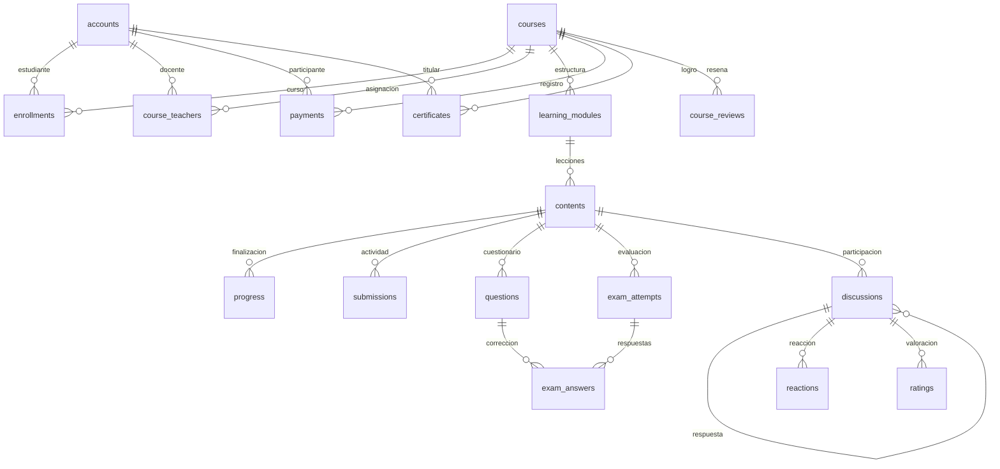

# Modelo y diccionario de datos

## Modelo lógico

La jerarquía académica es curso → módulo → contenido. Las cuentas unifican administración, docentes y estudiantes. Una matrícula y un pago son registros distintos: el pago conserva la operación administrativa y la matrícula determina el acceso.

## Diseño físico

El esquema actual utiliza H2, con 19 tablas académicas/de negocio, user_sessions y la tabla técnica de Flyway. V1 crea tablas, claves foráneas, unicidad e índices; V2 añade estados/rangos; V3 registra sesiones; V4 incorpora la vigencia del pago; V5 incorpora activación y rangos de evaluación. Los scripts canónicos están en `src/main/resources/db/migration/`. Hibernate utiliza `ddl-auto=validate`.

Todas las entidades tienen `id BIGINT` autogenerado como clave primaria y `version BIGINT` para control optimista. Las relaciones de entidad utilizan claves foráneas; los importes y resultados decimales tienen precisión 10 y escala 2. Las fechas de negocio se almacenan con precisión de microsegundos.

## Diccionario

### accounts — Account

| Campo | Tipo | Obligatorio | Relación / contenido |
|---|---|---|---|
| id | BIGINT | Sí | Clave primaria autogenerada |
| version | BIGINT | Sí | Versión optimista |
| full_name | VARCHAR(120) | Sí | fullName |
| email | VARCHAR(180) | Sí | email |
| password | VARCHAR(100) | Sí | Hash BCrypt; no contraseña original |
| role | VARCHAR(30) | Sí | ADMIN / DOCENTE / ESTUDIANTE |
| active | BOOLEAN | Sí | active |
| professional_title | VARCHAR(180) | No | professionalTitle |
| phone | VARCHAR(30) | No | phone |

Unicidad: `email`.

### courses — Course

| Campo | Tipo | Obligatorio | Relación / contenido |
|---|---|---|---|
| id | BIGINT | Sí | Clave primaria autogenerada |
| version | BIGINT | Sí | Versión optimista |
| title | VARCHAR(180) | Sí | title |
| description | VARCHAR(6000) | Sí | description |
| objectives | VARCHAR(2000) | Sí | objectives |
| category | VARCHAR(100) | Sí | category |
| level | VARCHAR(50) | Sí | level |
| duration_hours | INTEGER | Sí | durationHours |
| price | NUMERIC(10,2) | Sí | price |
| published | BOOLEAN | Sí | published |
| certificate_enabled | BOOLEAN | Sí | certificateEnabled |

### learning_modules — LearningModule

| Campo | Tipo | Obligatorio | Relación / contenido |
|---|---|---|---|
| id | BIGINT | Sí | Clave primaria autogenerada |
| version | BIGINT | Sí | Versión optimista |
| course_id | BIGINT | Sí | FK → courses.id |
| title | VARCHAR(180) | Sí | title |
| position | INTEGER | Sí | position |

### contents — Content

| Campo | Tipo | Obligatorio | Relación / contenido |
|---|---|---|---|
| id | BIGINT | Sí | Clave primaria autogenerada |
| version | BIGINT | Sí | Versión optimista |
| module_id | BIGINT | Sí | FK → learning_modules.id |
| title | VARCHAR(180) | Sí | title |
| type | VARCHAR(30) | Sí | Enumeración de Content |
| body | VARCHAR(12000) | Sí | body |
| resource_url | VARCHAR(1000) | No | resourceUrl |
| file_key | VARCHAR(100) | No | Nombre generado del archivo privado |
| file_name | VARCHAR(200) | No | fileName |
| preview | BOOLEAN | Sí | preview |
| position | INTEGER | Sí | position |
| max_attempts | INTEGER | Sí | maxAttempts |
| pass_percent | INTEGER | Sí | passPercent |
| exam_active | BOOLEAN | Sí | Habilita nuevos intentos de evaluación; valor inicial true |

### enrollments — Enrollment

| Campo | Tipo | Obligatorio | Relación / contenido |
|---|---|---|---|
| id | BIGINT | Sí | Clave primaria autogenerada |
| version | BIGINT | Sí | Versión optimista |
| student_id | BIGINT | Sí | FK → accounts.id |
| course_id | BIGINT | Sí | FK → courses.id |
| starts_at | TIMESTAMP(6) | Sí | startsAt |
| expires_at | TIMESTAMP(6) | Sí | expiresAt |
| status | VARCHAR(30) | Sí | status |

Unicidad: `student_id + course_id`.

### payments — Payment

| Campo | Tipo | Obligatorio | Relación / contenido |
|---|---|---|---|
| id | BIGINT | Sí | Clave primaria autogenerada |
| version | BIGINT | Sí | Versión optimista |
| student_id | BIGINT | Sí | FK → accounts.id |
| course_id | BIGINT | Sí | FK → courses.id |
| amount | NUMERIC(10,2) | Sí | amount |
| status | VARCHAR(30) | Sí | status |
| reference | VARCHAR(120) | Sí | reference |
| created_at | TIMESTAMP(6) | Sí | createdAt |
| confirmed_at | TIMESTAMP(6) | No | confirmedAt |
| expires_at | TIMESTAMP(6) | No | Vigencia definida al registrar/editar; nullable para preservar registros históricos |

### cart_items — CartItem

| Campo | Tipo | Obligatorio | Relación / contenido |
|---|---|---|---|
| id | BIGINT | Sí | Clave primaria autogenerada |
| version | BIGINT | Sí | Versión optimista |
| student_id | BIGINT | Sí | FK → accounts.id |
| course_id | BIGINT | Sí | FK → courses.id |

Unicidad: `student_id + course_id`.

### progress — Progress

| Campo | Tipo | Obligatorio | Relación / contenido |
|---|---|---|---|
| id | BIGINT | Sí | Clave primaria autogenerada |
| version | BIGINT | Sí | Versión optimista |
| student_id | BIGINT | Sí | FK → accounts.id |
| content_id | BIGINT | Sí | FK → contents.id |
| completed_at | TIMESTAMP(6) | Sí | completedAt |

Unicidad: `student_id + content_id`.

### submissions — Submission

| Campo | Tipo | Obligatorio | Relación / contenido |
|---|---|---|---|
| id | BIGINT | Sí | Clave primaria autogenerada |
| version | BIGINT | Sí | Versión optimista |
| student_id | BIGINT | Sí | FK → accounts.id |
| content_id | BIGINT | Sí | FK → contents.id |
| attempt_number | INTEGER | Sí | attemptNumber |
| file_key | VARCHAR(100) | Sí | Nombre generado del archivo privado |
| file_name | VARCHAR(200) | Sí | fileName |
| comment | VARCHAR(1000) | Sí | comment |
| grade | NUMERIC(10,2) | No | grade |
| feedback | VARCHAR(1000) | No | feedback |
| created_at | TIMESTAMP(6) | Sí | createdAt |

Unicidad: `student_id + content_id + attempt_number`.

### questions — Question

| Campo | Tipo | Obligatorio | Relación / contenido |
|---|---|---|---|
| id | BIGINT | Sí | Clave primaria autogenerada |
| version | BIGINT | Sí | Versión optimista |
| content_id | BIGINT | Sí | FK → contents.id |
| type | VARCHAR(30) | Sí | Enumeración de Question |
| prompt | VARCHAR(2000) | Sí | prompt |
| options_text | VARCHAR(3000) | Sí | optionsText |
| correct_answer | VARCHAR(2000) | Sí | Respuesta reservada para gestión y corrección |
| explanation | VARCHAR(2000) | Sí | explanation |
| points | INTEGER | Sí | points |
| position | INTEGER | Sí | position |

### exam_attempts — ExamAttempt

| Campo | Tipo | Obligatorio | Relación / contenido |
|---|---|---|---|
| id | BIGINT | Sí | Clave primaria autogenerada |
| version | BIGINT | Sí | Versión optimista |
| student_id | BIGINT | Sí | FK → accounts.id |
| content_id | BIGINT | Sí | FK → contents.id |
| attempt_number | INTEGER | Sí | attemptNumber |
| percent | NUMERIC(10,2) | Sí | percent |
| stars | INTEGER | Sí | stars |
| passed | BOOLEAN | Sí | passed |
| created_at | TIMESTAMP(6) | Sí | createdAt |

Unicidad: `student_id + content_id + attempt_number`.

### exam_answers — ExamAnswer

| Campo | Tipo | Obligatorio | Relación / contenido |
|---|---|---|---|
| id | BIGINT | Sí | Clave primaria autogenerada |
| version | BIGINT | Sí | Versión optimista |
| attempt_id | BIGINT | Sí | FK → exam_attempts.id |
| question_id | BIGINT | Sí | FK → questions.id |
| answer_text | VARCHAR(3000) | Sí | answerText |
| correct | BOOLEAN | Sí | correct |
| earned_points | INTEGER | Sí | earnedPoints |

Unicidad: `attempt_id + question_id`.

### discussions — Discussion

| Campo | Tipo | Obligatorio | Relación / contenido |
|---|---|---|---|
| id | BIGINT | Sí | Clave primaria autogenerada |
| version | BIGINT | Sí | Versión optimista |
| content_id | BIGINT | Sí | FK → contents.id |
| author_id | BIGINT | Sí | FK → accounts.id |
| parent_id | BIGINT | No | FK → discussions.id |
| body | VARCHAR(4000) | Sí | body |
| deleted | BOOLEAN | Sí | deleted |
| created_at | TIMESTAMP(6) | Sí | createdAt |

### reactions — Reaction

| Campo | Tipo | Obligatorio | Relación / contenido |
|---|---|---|---|
| id | BIGINT | Sí | Clave primaria autogenerada |
| version | BIGINT | Sí | Versión optimista |
| post_id | BIGINT | Sí | FK → discussions.id |
| actor_id | BIGINT | Sí | FK → accounts.id |
| type | VARCHAR(30) | Sí | Enumeración de Reaction |

Unicidad: `post_id + actor_id`.

### ratings — Rating

| Campo | Tipo | Obligatorio | Relación / contenido |
|---|---|---|---|
| id | BIGINT | Sí | Clave primaria autogenerada |
| version | BIGINT | Sí | Versión optimista |
| post_id | BIGINT | Sí | FK → discussions.id |
| actor_id | BIGINT | Sí | FK → accounts.id |
| score | INTEGER | Sí | score |

Unicidad: `post_id + actor_id`.

### course_reviews — CourseReview

| Campo | Tipo | Obligatorio | Relación / contenido |
|---|---|---|---|
| id | BIGINT | Sí | Clave primaria autogenerada |
| version | BIGINT | Sí | Versión optimista |
| course_id | BIGINT | Sí | FK → courses.id |
| author_id | BIGINT | Sí | FK → accounts.id |
| body | VARCHAR(2000) | Sí | body |
| score | INTEGER | Sí | score |
| created_at | TIMESTAMP(6) | Sí | createdAt |

Unicidad: `course_id + author_id`.

### certificates — Certificate

| Campo | Tipo | Obligatorio | Relación / contenido |
|---|---|---|---|
| id | BIGINT | Sí | Clave primaria autogenerada |
| version | BIGINT | Sí | Versión optimista |
| student_id | BIGINT | Sí | FK → accounts.id |
| course_id | BIGINT | Sí | FK → courses.id |
| code | VARCHAR(7) | Sí | code |
| student_name | VARCHAR(120) | Sí | Texto conservado al emitir el certificado |
| course_title | VARCHAR(180) | Sí | Texto conservado al emitir el certificado |
| issued_at | TIMESTAMP(6) | Sí | issuedAt |

Unicidad: `student_id + course_id`; `code`.

### audit_entries — AuditEntry

| Campo | Tipo | Obligatorio | Relación / contenido |
|---|---|---|---|
| id | BIGINT | Sí | Clave primaria autogenerada |
| version | BIGINT | Sí | Versión optimista |
| actor_id | BIGINT | Sí | FK → accounts.id |
| action | VARCHAR(80) | Sí | action |
| details | VARCHAR(1000) | Sí | details |
| created_at | TIMESTAMP(6) | Sí | createdAt |

### course_teachers — asignación docente

| Campo | Tipo | Relación |
|---|---|---|
| course_id | BIGINT | FK → courses.id |
| teacher_id | BIGINT | FK → accounts.id |

Clave primaria compuesta: course_id + teacher_id. La capa de negocio exige una cuenta DOCENTE activa.

### user_sessions — historial de acceso

| Campo | Tipo | Obligatorio | Relación / contenido |
|---|---|---|---|
| id | BIGINT | Sí | Clave primaria autogenerada |
| account_id | BIGINT | Sí | FK → accounts.id |
| role_at_login | VARCHAR(30) | Sí | Rol al ingresar |
| logged_in_at | TIMESTAMP(6) | Sí | Entrada |
| logged_out_at | TIMESTAMP(6) | No | Salida explícita registrada |
| expires_at | TIMESTAMP(6) | Sí | Vencimiento de sesión |

Esta tabla añadida por V3 conserva accesos reales, separados de la auditoría de operaciones académicas. No contiene el identificador secreto de la sesión HTTP ni una versión optimista.

## Restricciones relevantes

- Estados de pago: PENDIENTE, CONFIRMADO y ANULADO; un pago confirmado tiene fecha de confirmación.
- Estados de matrícula: ACTIVA y CANCELADA; expires_at es posterior a starts_at. La vigencia no se guarda como un estado mutable: se calcula con las fechas.
- Precio e importe no negativos; duración de 1 a 2000 horas.
- Orden de módulo/contenido/pregunta entre 1 y 999. Actividades: 1–10 intentos; evaluaciones: 1–20 o 0 para ilimitados; umbral de aprobación: 0–100. Número de intento mayor o igual a 1, sin límite físico de 10.
- Actividad calificada de 0 a 20; resultados de evaluación entre 0 y 100; estrellas de 0 a 3.
- Valoraciones y reseñas de 1 a 5.
- Código de certificado numérico de siete dígitos, único; único certificado por estudiante/curso.
- Las respuestas conservan el texto enviado, la corrección y los puntos del intento; no se recalculan al volver a consultar.

No se incluyen datos personales reales ni scripts de extracción de otros sistemas. Los registros de demostración los crea DemoData de forma transaccional sobre una base vacía.
